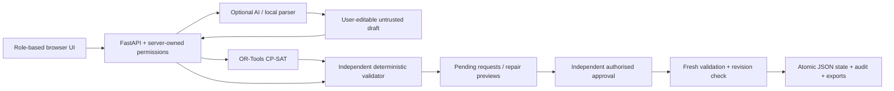

# CIT ChronoGrid

Campus timetable and venue management for Chilika Institute of Technology: constraint-checked teaching schedules, Week 8 exams, English/Hinglish booking drafts, minimum-change repairs, private requests and independent approvals.

**Hosted demo:** pending — the team will add its public deployment URL. `localhost` is a local development address, not the judge demo link.

**Dataset:** the included data is synthetic development data: 27 rooms, 40 faculty, 14 groups / 980 students, 62 courses, 189 sessions / 243 teaching hours, 25 event requests and 41 exams. The official dataset and validator were not supplied.

## Tech stack

- Python 3.12, FastAPI, Uvicorn and Pydantic.
- Google OR-Tools CP-SAT for scheduling and minimum-change repairs.
- Independent deterministic Python constraint validator.
- Native HTML/CSS/JavaScript with responsive, image-free role workspaces.
- Atomic JSON state/audit storage; expiring, revocable sessions persisted as token hashes.
- Optional OpenAI-compatible model parser; conservative local rule parser and manual forms work without an API key.
- pytest regression tests; pinned runtime dependencies in `requirements.txt`, installed transitive versions in `requirements-lock.txt`.

## Architecture



AI never decides validity, grants priority or changes the timetable directly. All submissions and approvals run code-based checks. See [AI_USAGE.md](AI_USAGE.md), [THIRD_PARTY.md](THIRD_PARTY.md) and [CONSTRAINTS.md](CONSTRAINTS.md).

## Setup

Install Python 3.12, then from the repository root:

```powershell
python -m venv .venv
.venv\Scripts\python.exe -m pip install -r requirements.txt
$env:DEMO_MODE = 'true'
.venv\Scripts\python.exe -m uvicorn backend.main:app --host 127.0.0.1 --port 8000 --workers 1
```

On macOS/Linux:

```bash
python3 -m venv .venv
.venv/bin/python -m pip install -r requirements.txt
DEMO_MODE=true .venv/bin/python -m uvicorn backend.main:app --host 127.0.0.1 --port 8000 --workers 1
```

Open [http://127.0.0.1:8000](http://127.0.0.1:8000), choose a sign-in portal and use the demo credentials below. Fresh checkouts start without a generated timetable. Admin can **Generate timetable**, or use **Reset demo data** to restore and solve the clean synthetic dataset. Generation reports real solver stages and may take tens of seconds.

The app serves frontend and API from one origin. No Node build is needed. System fonts work without the optional Google Fonts connection. Environment files are not loaded automatically: set variables in the shell/host; `.env.example` lists every supported application variable and contains no real keys.

## Demo accounts

All five identities use **`ChronoGrid2026!`** by default. `DEMO_PASSWORD` can override it. Four roles are represented, with a second Admin for independent approval.

| Portal | Username | Role and scope |
| --- | --- | --- |
| `/login/admin` | `admin` | Administrator: generate, reset, import/export and review others' requests |
| `/login/deputy-admin` | `admin2` | Independent second Administrator; cannot approve its own requests |
| `/login/department-coordinator` | `coordinator` | CSE coordination, department/guest bookings and eligible CSE lab approvals |
| `/login/faculty` | `faculty` | Faculty F01: own leave, session moves and extra-class requests |
| `/login/club-representative` | `club` | Club bookings, own request history, alternatives and cancellation |

Username fields are editable. The server checks the account belongs to the selected portal. Each portal displays its demo username/password when `DEMO_MODE=true`. That flag also enables explicit judge-demo role switching; disable it for normal credential-based operation. These are disposable demonstration accounts, not production university identities.

**Admin reset:** the **Reset demo data** button restores the baseline dataset and regenerates a checked timetable, so judges can start clean. Self-approval is blocked. Sign in as `admin2` to approve a proposal submitted by `admin`.

## Main workflows

1. **Timetable:** filter by group/faculty/room. Maintenance and leave show as Unavailable. Empty cells are not a promise that every scheduling constraint is satisfied.
2. **Campus Assistant:** create an editable booking or schedule/leave draft; review the populated fields, resolve clarifications and submit. Manual forms remain usable during AI outage. Assistant timetable drafts populate session/day/period/room controls.
3. **Venue requests:** submission checks capacity, type, accessibility, timing, maintenance and room/mandatory-group clashes. Conflicts produce room/time alternatives. Submission does not reserve space until independent approval.
4. **Changes and leave:** stage a minimum-change repair. Review before/after placements before approval. Leave approval activates the validated repaired timetable. Infeasible leave stays pending; stale previews cannot apply.
5. **Imports:** JSON only, up to 5 MB. Scoped change files stage repairs. Complete dataset imports get a solved preview with conflicts and alternatives before explicit replacement. Invalid/infeasible imports and cancellation preserve the current timetable. Approved manual bookings/leave are protected. See [SESSION_IMPORT_GUIDE.md](SESSION_IMPORT_GUIDE.md).
6. **Privacy and reviews:** requesters see their own history; authorised reviewers see actionable pending work. Approval buttons are server-authorised per request. Public approved room occupancy remains visible.
7. **Exams:** day-filtered Week 8 agenda with physical/effective seat counts; effective capacity is `floor(physical seats / 2)`.

## Required exports

- [`exports/schedule.json`](exports/schedule.json): app-generated baseline for [`data/cit_synthetic.json`](data/cit_synthetic.json).
- [`exports/schedule_after.json`](exports/schedule_after.json): after applying [`data/sample_disruption.json`](data/sample_disruption.json) and independent approval.
- [`exports/dataset_after.json`](exports/dataset_after.json): complete post-disruption input for validation.
- [`exports/repair_proposal.json`](exports/repair_proposal.json): before/after diff, moved counts, solver status and proof metadata.

Regenerate these through the app's API in an isolated temporary runtime (does not reset your live campus state):

```powershell
.venv\Scripts\python.exe scripts/generate_exports.py
.venv\Scripts\python.exe scripts/validate_schedule.py data/cit_synthetic.json exports/schedule.json
.venv\Scripts\python.exe scripts/validate_schedule.py exports/dataset_after.json exports/schedule_after.json
```

These are synthetic example exports, not official-dataset certification. Deliberately conflicting test files and instructions are in [fixtures/README.md](fixtures/README.md).

## Verification

```powershell
.venv\Scripts\python.exe -m pytest -q
node scripts/verify_slot_rendering.cjs
```

Node is optional and only needed for the additional renderer smoke check. The latest local suite passed **109 tests**. Tests cover all 14 hard constraints, six soft criteria, scopes, category abuse, manual outage fallback, competing approvals, leave repair, session expiry/restart, import conflicts and stale previews. Browser evidence and limits are documented in [VERIFICATION.md](VERIFICATION.md).

## Deployment

The included Dockerfile runs the complete Python backend and frontend on port 8000. Use a Python/container host with durable `/app/runtime` and `/app/exports` storage and **one worker**. Use HTTPS and `COOKIE_SECURE=true` on the public host. Never commit a real AI key; configure it in the host's environment.

```bash
docker build -t chronogrid .
docker run --rm -p 8000:8000 -e DEMO_MODE=true -v chronogrid-runtime:/app/runtime -v chronogrid-exports:/app/exports chronogrid
```

A GitHub source upload is not a deployed Python application. The team will add the public demo URL and verify all four roles, independent second Admin, reset and session behavior on that host before submission. See [SUBMISSION.md](SUBMISSION.md).

## Known limitations

- Official CIT starter files, export format and unmodified official validator were not supplied; this implementation uses a clearly labelled synthetic development schema.
- Soft scoring uses provisional unit weights. Local repair counts/proofs must still be compared with the official scoring rules.
- No live external LLM is configured or accuracy-certified. The no-key parser is deliberately conservative; configured timeout/quota/malformed-output fallback is tested.
- Single-process JSON persistence is intended for the prototype. Campus SSO, production per-person identities, database/multi-worker deployment and rate limiting are not implemented.
- Venue priorities do not silently displace teaching. Use an explicit checked repair and independent approval for academic changes. Counter-offers reserve nothing.
- Google Fonts are optional external resources with system fallbacks. Signed-in pages use no photographs; unused historical reference photographs are excluded from the repository.
- The public demo URL and walkthrough recording remain to be supplied by the team. Localhost is not accessible to judges.
