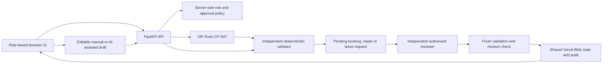

# CIT ChronoGrid

> Developed by **Team Inferno** for the **Tech Zypher Hackathon**.

**CIT ChronoGrid** is a role-based campus timetable and venue-management platform for Chilika Institute of Technology. It creates and validates Week 7 teaching schedules, Week 8 midsem examinations, venue requests, timetable repairs and faculty leave plans.

**Live demo:** [chronogrid-iitbbsr.vercel.app](https://chronogrid-iitbbsr.vercel.app)

> The bundled dataset is synthetic development data. It is not an official CIT dataset or a claim of official validation.

## What it does

- Generates a clash-checked teaching timetable and midsem schedule with OR-Tools CP-SAT.
- Enforces hard constraints through independent deterministic Python validation.
- Supports English/Hinglish request drafting, with editable forms and a manual fallback.
- Finds compatible rooms and timing alternatives with seat capacity, room type, access and clash details.
- Stages timetable repairs, bookings and leave requests for independent approval.
- Applies approved bookings, repairs and leave plans to the shared timetable revision.
- Maintains strict approval authority, self-approval protection and event-priority ordering.

## Architecture



## Dataset and supplied artifacts

The synthetic dataset is in [`data/cit_synthetic.json`](data/cit_synthetic.json).

| Item | Count / scope |
| --- | --- |
| Rooms | 27: classrooms, lecture halls, auditorium, seminar halls, open-air theatre and 7 labs |
| Faculty | 40 |
| Student groups | 14 / 980 students |
| Courses | 62 |
| Teaching sessions | 189 / 243 weekly teaching hours |
| Spectra venue requests | 25 seed requests, including cancelled requests and original text |
| Midsem examinations | 41 |

CSV mirrors are available under [`data/cit_synthetic_csv`](data/cit_synthetic_csv), with the packaged archive at [`exports/cit_synthetic_dataset_csv.zip`](exports/cit_synthetic_dataset_csv.zip). Every session already contains its faculty and student-group assignments; scheduling assigns a day, start period and room.

Useful included files:

- [`data/sample_disruption.json`](data/sample_disruption.json): a sample change file.
- [`exports/schedule.json`](exports/schedule.json): validated baseline schedule.
- [`exports/schedule_after.json`](exports/schedule_after.json): schedule after the sample disruption.
- [`exports/dataset_after.json`](exports/dataset_after.json): matching post-disruption dataset.
- [`scripts/validate_schedule.py`](scripts/validate_schedule.py): deterministic local validation command.
- [`CONSTRAINTS.md`](CONSTRAINTS.md): hard constraints and soft objectives.

## Roles, approval authority and priority

Nobody can approve their own request.

| Role | Can submit / do | Can approve |
| --- | --- | --- |
| Admin (Dean's Office) | Generate/reset timetable, import data, edit event priority, submit/manage requests | Any independent booking, timetable repair or leave request |
| Deputy Admin | Same Admin powers | Any request not submitted by that identity |
| Department Coordinator | Department session changes and department-event bookings | Independent bookings in that coordinator's department labs only |
| Faculty | View own timetable, request own leave, extra or moved sessions | Nothing |
| Club Representative | Submit/cancel venue requests and see their status/reason | Nothing |

When competing requests need the same room/time, the server enforces this order before a lower-priority request can be approved:

1. Exams
2. Regular classes
3. Institute events
4. Guest lectures
5. Department events
6. Club events

The visible approval button is not authoritative; every decision is rechecked server-side against identity, scope, current timetable revision and constraints.

## Hard-constraint checks

The deterministic validator covers, among other checks:

- exactly-once session placement;
- faculty, student-group, room and mandatory-group clash prevention;
- capacity, room-type and accessible-room requirements;
- faculty and room unavailability/maintenance;
- lunch protection and permitted three-hour lab windows;
- elective basket synchronisation;
- faculty daily load limits;
- approved booking conflicts; and
- fixed-slot preservation.

Run it directly:

```powershell
.venv\Scripts\python.exe scripts/validate_schedule.py data/cit_synthetic.json exports/schedule.json
.venv\Scripts\python.exe scripts/validate_schedule.py exports/dataset_after.json exports/schedule_after.json
```

The validator reports hard-constraint violations and schedule metrics. It is the validity authority; a model response, browser response or solver response is never treated as proof that a schedule is valid.

## Setup

Requires Python 3.12+.

```powershell
python -m venv .venv
.venv\Scripts\python.exe -m pip install -r requirements.txt
$env:DEMO_MODE = 'true'
.venv\Scripts\python.exe -m uvicorn backend.main:app --host 127.0.0.1 --port 8000 --workers 1
```

Open [http://127.0.0.1:8000](http://127.0.0.1:8000). No Node build is required. Copy environment-variable names from [`.env.example`](.env.example); do not commit real credentials.

## Demo accounts

All demo accounts use password **`ChronoGrid2026!`** unless `DEMO_PASSWORD` is configured.

| Portal | Username | Password | Purpose |
| --- | --- | --- | --- |
| `/login/admin` | `admin` | `ChronoGrid2026!` | Dean's Office / universal independent reviewer |
| `/login/deputy-admin` | `admin2` | `ChronoGrid2026!` | Second Admin for independent approval |
| `/login/department-coordinator` | `coordinator` | `ChronoGrid2026!` | CSE department coordinator |
| `/login/faculty` | `faculty` | `ChronoGrid2026!` | Faculty F01 / Dr. Mohanty |
| `/login/club-representative` | `club` | `ChronoGrid2026!` | Robotics Club representative |

The Admin workspace has **Reset demo data**, which restores the validated baseline so judges can begin from a clean state.

## AI use and manual fallback

AI is optional. The Campus Assistant can read a request, identify missing details and produce an **untrusted editable draft**. It may be configured with an OpenAI-compatible endpoint through `AI_BASE_URL`, `AI_MODEL` and server-only `AI_API_KEY`.

The model is not allowed to:

- decide schedule or booking validity;
- assign event priority;
- grant roles or approval authority;
- approve a request;
- override a fixed slot; or
- write persistent timetable state.

All model output passes strict schemas, server-side permission checks and deterministic validation before submission. If no key is present, the provider fails, credits end, or the response is malformed, the manual booking and timetable-change forms remain available. See [AI_USAGE.md](AI_USAGE.md) for the full declaration, prompt location and development-tool disclosure.

## Implementation compliance

- The application uses a Python/FastAPI/native-JavaScript stack, but the architecture does not depend on a particular UI framework.
- Any enabled hosted model uses a team-controlled API key configured only in the deployment environment; keys are never committed.
- Every model/API used by the product and every AI development tool used for this repository is declared in [AI_USAGE.md](AI_USAGE.md).
- Open-source libraries and their licences are declared in [THIRD_PARTY.md](THIRD_PARTY.md).
- Manual forms remain functional if an AI provider fails, runs out of quota or is intentionally not configured.
- The project team is responsible for ensuring repository origin and commit history meet the event's submission rules.

## Third-party software

Primary dependencies are pinned in [`requirements.txt`](requirements.txt): Python, FastAPI, Pydantic, Uvicorn, HTTPX, pytest, OR-Tools and Vercel Blob. OR-Tools is used for optimisation; it is not the final validity authority. See [THIRD_PARTY.md](THIRD_PARTY.md) for licences, optional fonts and reference-template disclosure.

## Exports, imports and verification

Regenerate the checked synthetic exports:

```powershell
.venv\Scripts\python.exe scripts/generate_exports.py
```

Run regression checks:

```powershell
.venv\Scripts\python.exe -m pytest -q
node scripts/verify_slot_rendering.cjs
```

JSON imports receive a preview before replacement. Change files stage a repair rather than silently altering the active schedule. Imports and approvals are revalidated before they affect campus state. See [SESSION_IMPORT_GUIDE.md](SESSION_IMPORT_GUIDE.md) and [VERIFICATION.md](VERIFICATION.md).

## Deployment

The live Vercel deployment uses FastAPI and a private Vercel Blob store for shared role requests, approvals, timetable revisions and audit state. `AUTH_SIGNING_SECRET` and `BLOB_READ_WRITE_TOKEN` are host-managed secrets and must never be committed. Generated artifacts use writable runtime storage in serverless deployments.

For a long-running single-host deployment, the included Dockerfile supports a mounted runtime directory:

```bash
docker build -t chronogrid .
docker run --rm -p 8000:8000 -e DEMO_MODE=true -v chronogrid-runtime:/app/runtime chronogrid
```

## Known limitations

- The repository uses a labelled synthetic dataset because the official starter dataset and official checker were not supplied.
- Soft-constraint weights are provisional and should be compared with the official scoring specification when available.
- This is a demo authentication model, not production campus SSO or per-person identity management.
- The private Blob state store is suitable for this demo; a production rollout should use transactional database storage, rate limiting and operational monitoring.
- No live AI provider is required or configured by default.

## Contributors

- **Shinjan** ([shinjan-2006](https://github.com/shinjan-2006)) — project owner and product direction.
- **OpenAI Codex** — AI-assisted implementation, debugging, testing, UI refinement and documentation; full disclosure in [AI_USAGE.md](AI_USAGE.md).
